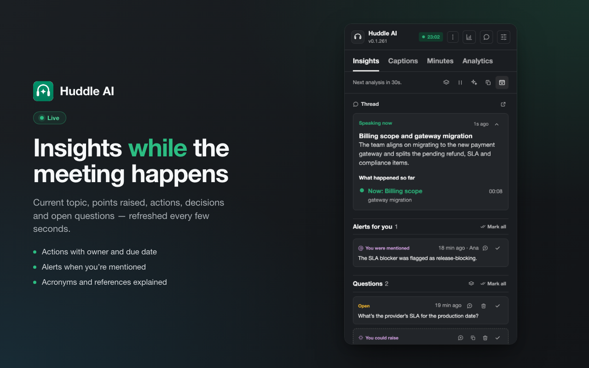

# Huddle AI

Chrome extension that reads the live captions of a Slack huddle and shows insights (current topic, points raised, action items, decisions, open questions) in Chrome's side panel, using Claude.



## Setup

```bash
npm install
npm run build        # or: npm run watch
npm test             # unit + React component tests (Node test runner)
```

1. Open `chrome://extensions`, turn on **Developer mode** and click **Load unpacked**, then pick the `extension/` folder.
2. Click the extension's toolbar icon to open the side panel.
3. In the panel, open **⋯ → Configurações** and paste an Anthropic API key.
4. In Slack on the web (`app.slack.com`), join a huddle and open the **Captions** tab in the huddle window.

The extension can only see huddle windows opened after the Slack tab loaded with the extension installed. After installing or reloading the extension, reload the Slack tab and open the huddle again.

## How it works

| File | Role |
|---|---|
| `extension/page-hook.js` | Runs in app.slack.com's own JS world before Slack loads. Slack opens the huddle as an `about:blank` popup and renders into it from the main tab; Chrome doesn't run content scripts there, so this wraps `window.open` and reads the popup from the opener. |
| `extension/scanner.js` | Finds the Captions tab panel in a window and turns each row (one avatar per row) into `{ speaker, text }`. |
| `extension/content.js` | Bridge: relays what the page finds to the background worker, and side-panel requests back to the page. |
| `extension/background.js` | Keeps the current huddle and its captions in `chrome.storage.session`; archives finished huddles into `chrome.storage.local` when history is on. |
| `src/sidepanel/main.jsx` | React entry: mounts `<App>` into `#app`. |
| `src/sidepanel/App.jsx` | The side panel container (React). Holds the UI state, mirrors `chrome.storage`, runs the live loop (every N seconds, when new captions arrive, it asks Claude for updated insights), and wires every action. |
| `src/sidepanel/views/*.jsx` | The screens as React components: Header/Tabs/InfoBar, Insights, Captions, Ata, Chat, Idle, Settings, Logs, Atas, Import. |
| `src/sidepanel/ui/*.jsx` | Shared React pieces: `Icon`, `Markdown` (marked + DOMPurify), and `primitives` (`Avatar`, `Section`, `Field`, …). |
| `src/sidepanel/lib/*.js` | Pure, DOM-free logic (formatting, transcript parsing, minutes text/grouping, log text). Unit-tested in Node. |
| `src/sidepanel/insights.js` | Claude calls: structured insights and the structured minutes (`messages.parse` + zod). |
| `src/sidepanel/drive.js` | Google Drive access via `chrome.identity.getAuthToken`. Uploads one minutes file per huddle, scope `drive.file` (the extension only ever sees files it created). |

The side panel is a React 19 app, bundled (with the pure logic and Claude SDK) into `extension/sidepanel.js` by esbuild (`npm run build`).

The session minutes are written when the huddle window closes (toggle in the Ata tab or settings) or on demand with **Gerar ata agora**. Keep the side panel open while it is generated. Finished sessions are kept with the huddle history in `chrome.storage.local`.

Each saved session holds the whole huddle — its transcript, the insights as they stood, and the generated minutes. **Carregar** (on a row under **Sessões anteriores** or in the opened session) loads it back into the app: the panel shows what it showed that day and the chat answers questions about that meeting.

**Importar transcrição** (upload button on **Sessões anteriores**, or on the idle screen) takes a transcript copied from a meeting the extension did not capture. Paste it — `Nome: fala` lines are split by speaker, otherwise one line per utterance — and it becomes a loaded session with its minutes and insights generated (needs the API key). It is archived like any other session.

## Google Drive

Each new huddle archives the previous one as a session (its minutes). From the **Ata** tab — current or any past one under **Sessões anteriores** — the minutes can be downloaded as `.md` or sent to Google Drive with the cloud button. The first send prompts for Google consent; the Drive link is kept on the record.

Drive uses an OAuth client **you** create — the extension ships a placeholder. One-time setup:

1. In [Google Cloud Console](https://console.cloud.google.com/), create (or pick) a project.
2. **APIs & Services → Library**: enable **Google Drive API**.
3. **APIs & Services → OAuth consent screen**: configure it (External is fine), add your Google account under **Test users**, and add the scope `.../auth/drive.file`.
4. **APIs & Services → Credentials → Create credentials → OAuth client ID**, type **Chrome Extension**, item ID `lnffnbbmkiafgmglepfcjdchaahjoooe`.
5. Copy the generated client ID into `extension/manifest.json` → `oauth2.client_id`, then reload the extension.

The extension ID is pinned to `lnffnbbmkiafgmglepfcjdchaahjoooe` by the `key` field in `extension/manifest.json`, so it stays the same across machines and reloads. The private key is `key.pem` at the repo root (git-ignored — keep it, it's what the `key` was derived from and what you'd sign a `.crx` with; don't share it). To regenerate: `openssl genrsa 2048 > key.pem`, then set `key` to `openssl rsa -in key.pem -pubout -outform DER | base64 | tr -d '\n'` and the item ID to `openssl rsa -in key.pem -pubout -outform DER | shasum -a 256 | head -c 32 | tr '0-9a-f' 'a-p'`.

Connect/disconnect under **⋯ → Configurações → Google Drive**. Disconnect revokes the token.

The API key stays in `chrome.storage.local` and requests go straight from the browser to `api.anthropic.com`.

**Postar no thread** writes the insights (or the summary) as a draft in the huddle's Thread composer. Nothing is sent automatically: review it in Slack, press Enter, then switch the huddle back to the Captions tab so captions keep flowing.

## When captions are not picked up

There are three ways to read captions, under **⋯ → Configurações → Legendas**:

- **Automático** — the default. Reads the Captions tab panel when that tab is open (full transcript, `p-huddle_event_log__*`) and the closed-caption overlay over the video tiles (`.p-huddle_closed_captions`) when it is not. The overlay is in the huddle footer whenever captions are on, so capture starts as soon as captions are enabled — no need to open the Captions tab. Opening the tab then upgrades to the full transcript.
- **Painel de legendas (aba Captions)** — only the avatar/tab panel. Needs the Captions tab open.
- **Legendas sobre os vídeos** — only the overlay. Shows just the last few lines (they fade), but needs no tab.

The choice takes effect when the Slack tab is next (re)loaded.

Slack's markup changes without notice. Open **⋯ → Configurações → Diagnóstico** while the captions are visible: the HTML of the captions area is copied to the clipboard, so the selectors in `scanner.js` can be adjusted.
